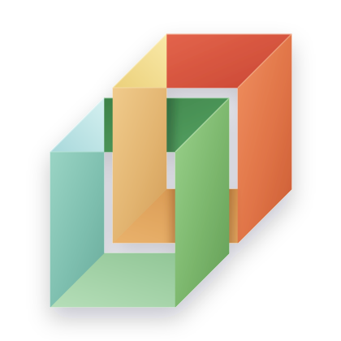
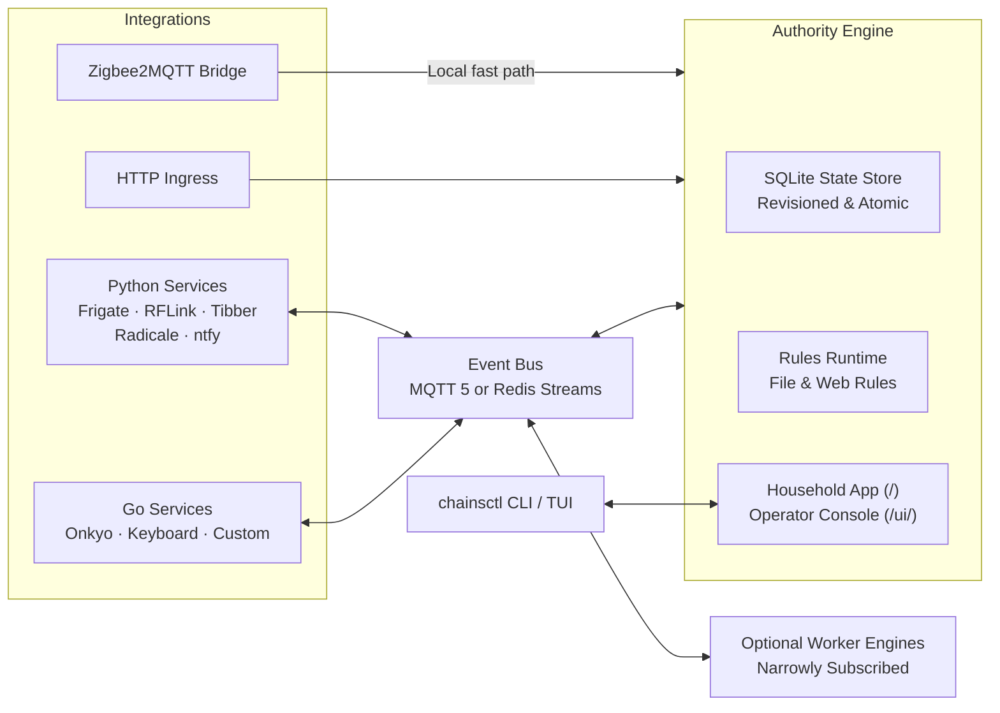

<p align="center">
  
</p>

<h1 align="center">Chains Automation</h1>

<p align="center">
  <strong>Fast, local-first home automation with a readable rules language, coherent device state, and clean web apps.</strong>
</p>

<p align="center">
  <a href="#try-it-in-two-minutes">Quickstart</a> ·
  <a href="docs/rules.md">Rules Guide</a> ·
  <a href="docs/household-dashboards.md">Household App</a> ·
  <a href="docs/operator-web.md">Operator Console</a> ·
  <a href="docs/getting-started.md">Install</a> ·
  <a href="#documentation">Docs</a>
</p>

---

Chains connects your devices, sensors, and services over **MQTT 5** or **Redis Streams**. A lightweight Go engine commits every observation to a revisioned **SQLite** state store before rules see it, runs automations written in a clean Python-like `.chains` DSL, and serves both a **Household app** for everyday control and an **Operator console** for rules, devices, and live trace debugging.

## Why Chains?

| Feature | What it gives you |
| --- | --- |
| **Readable, stateful rules** | Write automations in indentation-based `.chains` files—or use the guided web editor and [rule templates](docs/rule-templates.md). Support for retriggerable timers (`rule.mode = "restart"`), bounded follow-up waits (`Event(..., timeout=...)`), `Sleep()`, calendar schedules, loops, and live publishing without restarts. |
| **No event/state race conditions** | Every observation commits device attributes atomically in SQLite *before* dispatching rules. Repeated readings (like button presses) still trigger rules, while leaf value changes emit `state.changed` notifications automatically. |
| **Two purpose-built web apps + TUI** | A dedicated **Household app** (`/`) with custom dashboards and auto-generated device controls, an **Operator console** (`/ui/`) with live **Watch**, **Trace Explorer**, and rule management, plus the keyboard-driven `chainsctl` terminal UI. |
| **Schema-first devices & placement** | Built-in classes (`toggle`, `light`, `dimmer`, `motion`), typed setters, hierarchical locations (`House.Bedroom.**`), and tags keep rules and dashboards decoupled from vendor quirks. |
| **Built-in Zigbee2MQTT & integrations** | First-class co-hosted Zigbee2MQTT bridge, Onkyo receivers, USB keyboards, RFLink, Frigate, Tibber Pulse, Radicale calendars, and ntfy notifications—plus ergonomic **Go** and **Python** SDKs. |
| **Single binary or distributed workers** | Run everything on one box, or scale out with narrowly subscribed worker engines that stay synchronized with the authority's state revisions. |

---

## Automations at a glance

Rules read like plain workflows—no nested YAML templates required.

**Retriggerable motion light** — turns on on motion, resets the timer on every new detection, and turns off cleanly after occupancy clears:

```text
rule.mode = "restart"
rule.timeout = 900

sensor = Device(service_id="zigbee2mqtt", device_id="0x00158d0001a2b3c4")
lamp   = Device(service_name=Zigbee2MQTT, device_name="hall/light")

Event(type="state.changed", device=sensor, attribute="occupancy", value=true, initial=false)
Set(device=lamp, attribute="power", value=true)

cleared = Event(type="state.changed", device=sensor, attribute="occupancy", value=false, timeout=600)
if cleared != null:
    Sleep(120)
Set(device=lamp, attribute="power", value=false)
```

**Bathroom humidity fan** — acts only when humidity crosses a threshold and the fan isn't already running:

```text
reading = Event(type="humidity.reported", device_id="bathroom-sensor")
fan = Device(service_id="sim-fan", device_id="fan")
if reading.data.value >= 70 and State(fan).power == false:
    Action("set_power", device=fan, value=true)
```

Read the **[Comprehensive Rules Guide](docs/rules.md)** for full language reference, calendar schedules, batch matching, built-in functions, and a cookbook of real-world patterns.

---

## Try it in two minutes

### Local interactive demo

On Linux with Go 1.23+, Node.js 22.12+, Mosquitto, and the `sqlite3` / `libmosquitto` dev headers ([prerequisites](docs/getting-started.md#prerequisites)):

```sh
./scripts/dev.sh
```

This starts Mosquitto, the Chains authority, a simulated bathroom fan, a humidity sensor, and both web apps (`http://127.0.0.1:8080/` and `http://127.0.0.1:8080/ui/`). In a second terminal, trigger the humidity rule and verify the fan turns on:

```sh
./scripts/dev.sh smoke
```

### Other ways to run

- **Native install** — install `chainsctl`, `chains`, and `chains-go-service` into `~/.local/bin`: see [Local development and installation](docs/getting-started.md#native-installation).
- **Docker Compose** — ready-to-run MQTT and Redis stacks: see [Docker and Compose](docs/docker-compose.md).
- **Kubernetes** — Kustomize manifests with persistent state and node-attached integrations: see [Kubernetes](docs/kubernetes.md).

<details>
<summary>Run the humidity example manually without the dev launcher</summary>

```sh
go build -buildvcs=false -o chains ./cmd/chains
./chains engine -rules examples/humidity.chains -debug
./chains fan -id sim-fan
./chains sensor -id humidity-sensor
mosquitto_pub -q 1 -t sensors/bathroom/humidity -m 72.5
```

For Redis Streams, add `-bus redis://localhost:6379` to the engine, fan, and sensor commands, and pass `-sensor-broker mqtt://localhost:1883` to the sensor adapter for its raw MQTT device feed. See [generic MQTT sensor adapter](docs/getting-started.md#generic-mqtt-sensor-adapter) to customize topics, formats, and schemas.

</details>

---

## How Chains fits together



- **One State Authority** validates registrations and observations, commits State revisions atomically in SQLite, dispatches local rules, and publishes updates onto the bus.
- **Optional Worker Engines** replicate a read view from the authority, recover from snapshots on reconnect, and can subscribe to only the event types their rules care about (`-types`).
- **Two Web Apps + CLI**:
  - **Household app (`/`)** — customizable [dashboards](docs/household-dashboards.md) and generated device controls for everyone at home.
  - **Operator console (`/ui/`)** — [State, Devices, Rules, Templates, Watch, and Trace Explorer](docs/operator-web.md).
  - **`chainsctl`** — [CLI and keyboard-driven TUI](docs/operator-cli.md) for inspecting state, watching live activity, and sending manual events.

---

## Integrations & SDKs

| Integration / SDK | Highlights | Guide |
| --- | --- | --- |
| **Zigbee2MQTT** | Co-hosted bridge on the authority with auto-discovery, retained state seeding, button actions, power, percentage `dimlevel`, and `motion` occupancy. | [Zigbee2MQTT guide](docs/zigbee2mqtt.md) |
| **Onkyo Receivers** | Local eISCP control for multi-zone power, volume, mute, and input selection. | [Onkyo guide](docs/onkyo.md) |
| **Bundled Python Services** | RFLink (433 MHz), Frigate (camera AI), Tibber Pulse (energy), Radicale (CalDAV), and ntfy (push notifications). | [Python services](docs/services-python.md) · [Radicale](docs/radicale.md) |
| **Bundled Go Services** | Managed Go runtime and USB `evdev` keyboard service. | [Go SDK guide](docs/sdk-go.md) |
| **Build your own** | Write custom integrations in Go (`sdk`) or Python (`chains-service MODULE:CLASS`) with automatic JSON Schema validation, heartbeats, and state sync. | [Go SDK](docs/sdk-go.md) · [Python SDK](docs/sdk-python.md) |

---

## Zigbee2MQTT bridge

Enable the built-in bridge on the state-authority engine:

```sh
CHAINS_Z2M_ENABLED=true \
CHAINS_Z2M_MQTT_URL=mqtt://localhost:1883 \
  ./chains engine -rules examples/z2m/button-to-light.chains
```

Retained reports seed State silently, button actions arrive under `data.action`, and lights/dimmers expose standardized `power` and percentage `dimlevel` setters. See the **[Zigbee2MQTT guide](docs/zigbee2mqtt.md)** for full configuration options, TLS/ACL setup, and mirroring behavior.

---

## Configure and extend

Configuration precedence is **environment → explicit CLI flags → JSON config file → defaults**. Set `CHAINS_CONFIG` or `-config`, or place `chains/config.json` under your XDG config directory. Default rules live at `$XDG_CONFIG_HOME/chains/rules.chains` and SQLite state at `$XDG_STATE_HOME/chains/state.sqlite`. Run `./chains engine -help` for all flags and `CHAINS_*` variables (`-scheduler=false`, `timezone`, `week` = `system` / `iso` / `sunday`).

- **Authority & workers:** Run one node with `id == authority`. Additional worker engines set a distinct `id`, the same `authority`, and optional `types` filters; workers restore their read view from the authority and resynchronize on gaps and reconnects. Place each action-producing rule on a single engine. Rule runs and missed triggers are live-only, so an interruption can skip a trigger even when the state update is persisted. Keep SQLite and `web_rules_dir` on persistent storage and arrange manual recovery if the authority host fails.
- **HTTP ingress:** Set `listen`, a bearer token (`CHAINS_TOKEN` or [`token_command`](docs/operator-cli.md#configure-the-authority)), and an `http` mapping in `config.json`:

```json
{
  "listen": "127.0.0.1:8080",
  "http": {
    "humidity": {
      "source": "humidity-sensor",
      "device": "bathroom-sensor",
      "type": "humidity.reported",
      "schema_version": "1",
      "attribute": "value",
      "state_attribute": "humidity"
    }
  }
}
```

With that source registered, `POST /events/humidity` bearing the token and a body of `72.5` submits a validated observation (`attribute` names the event payload field; `state_attribute` names the registered State attribute and defaults to `attribute`). Use a TLS reverse proxy for remote HTTP ingress, restrict MQTT broker ACLs by namespace and service identity, treat Redis clients with stream write permission as trusted participants, and use a private broker with `mqtts://` or `rediss://` for remote links.

- **Wire protocol & SDKs:** Version 3 (JSON or CBOR). Register stable service UUIDs and schema versions; both the [Go SDK](docs/sdk-go.md) and [Python SDK](docs/sdk-python.md) (`uv sync --project python --locked`) support atomic observations, silent State seeding, and actions. Upgrade engines and publishers together—see [wire v3 upgrade notes](docs/actions.md#upgrading-from-wire-v2). Both transport and codec boundaries are independent of the DSL and SQLite.

---

## Documentation

### Guides
- **[Writing Rules (DSL & Cookbook)](docs/rules.md)** — complete language guide, triggers, timers, built-ins, and real-world examples
- **[Rule Templates](docs/rule-templates.md)** — reusable TOML templates for the web console
- **[Events and State](docs/events.md)** — observations, atomic batches, leaf changes, and delivery guarantees
- **[Device Controls and Actions](docs/actions.md)** — device classes, schemas, setters, and action wait modes
- **[Device Locations and Tags](docs/devices.md)** — hierarchical placement patterns and catalog overrides
- **[Household Dashboards](docs/household-dashboards.md)** — home dashboards, builder, and household access
- **[Operator Web Console](docs/operator-web.md)** & **[Operator CLI / TUI](docs/operator-cli.md)** — live Watch, Trace Explorer, and `chainsctl`
- **[Rules Engine Concurrency & Latency](docs/rules-engine-concurrency.md)** — routing, locks, scaling across workers, and benchmarks
- **[Local Dev & Install](docs/getting-started.md)** · **[Docker Compose](docs/docker-compose.md)** · **[Kubernetes](docs/kubernetes.md)**
- **[Zigbee2MQTT](docs/zigbee2mqtt.md)** · **[Go SDK](docs/sdk-go.md)** · **[Python SDK](docs/sdk-python.md)** · **[Bundled Python Services](docs/services-python.md)** · **[Onkyo](docs/onkyo.md)** · **[Radicale](docs/radicale.md)**

### Architecture Decision Records
[0001 State-backed observations](docs/adr/0001-state-backed-observations.md) ·
[0002 Web-managed rules](docs/adr/0002-web-managed-rules.md) ·
[0003 Device classes & setters](docs/adr/0003-device-classes-and-setters.md) ·
[0004 Device placement](docs/adr/0004-device-placement.md) ·
[0005 Household dashboards](docs/adr/0005-household-dashboards.md) ·
[0006 Separate web apps](docs/adr/0006-separate-web-apps.md) ·
[0007 Household device access](docs/adr/0007-household-device-access.md) ·
[0008 Household dashboard editing](docs/adr/0008-household-dashboard-editing.md) ·
[0009 Declared operator State](docs/adr/0009-declared-operator-state.md) ·
[0010 Configured token sources](docs/adr/0010-configured-token-sources.md) ·
[0011 Rule template binding](docs/adr/0011-rule-template-binding.md) ·
[0012 DSL extensions & performance](docs/adr/0012-rules-engine-dsl-and-performance.md)

---

## Verification

```sh
go test -race ./...
uv run --project python --locked python -m unittest discover -s python/tests
CHAINS_TEST_MQTT=mqtt://127.0.0.1:1883 CHAINS_TEST_REDIS=redis://127.0.0.1:6379 \
  go test ./engine -run TestAutomation -bench BenchmarkSensorToAction -benchtime=256x
```

The broker-backed tests exercise a narrowly subscribed worker, registration, observed-state updates, causal action reports, and authority restart. The benchmark reports p50 and p99 latency from publishing a structured sensor event to receiving the action request (in bursts of 32), along with the peak sampled backlog in the worker's delivery queue.
