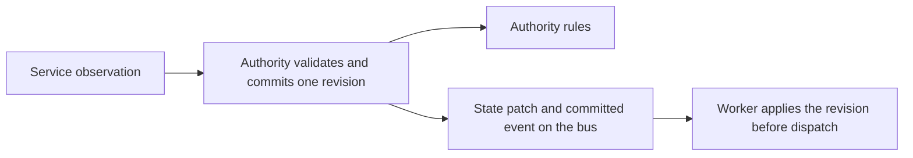

# Events and State

A service observation says what the service saw and which State values that sample updates. Chains commits those values before rules see the observation. Repeated readings and occurrences still reach rules. A separate `state.changed` notification carries each attribute transition.

## State paths and event payloads

Every reported value has a path of the form `service_id/device_id/attribute`. The service registers its stable ID, its devices, and the attribute names on each device. A device can represent a logical unit such as an amplifier output or a Frigate camera. Use the `system` device for service-wide attributes. Display names can repeat and change while IDs preserve the State paths.

An observation contains one patch per device. Each patch contains a `values` map for State and optional `data` for the event payload. Omitted `data` defaults to `values`. Keep durable values in `values` and put context specific to the sample in `data`. For example, Frigate writes a compact `last_object` summary to the camera's State and includes the full native update in the event payload. A button can report every press through an ordinary event and record the latest press in `last_key`. [Bundled service examples](services-python.md)

The event payload is validated against the registered JSON Schema for the event type and schema version. The State patch is checked against the device's declared attribute names and schemas. Attributes can hold JSON values, including objects, lists, and explicit `null`. A patch leaves omitted attributes and their timestamps intact. The reserved name `_attributes` exposes metadata through the DSL.

## Submitting an observation

A single-device submission uses the same envelope as a batch. A humidity sensor can submit one patch with `device_id: "bathroom-sensor"`, `values: {"humidity": 72.5}`, and `data: {"value": 72.5}`. The event payload uses the sensor's published schema and the State path uses the registered attribute name.

Here an amplifier service samples two zones in one observation. Both devices must be registered by `living-room-amp` with the `volume` and `muted` attributes. The registered `amplifier.sample` schema must accept each patch's payload separately.

```json
{
  "version": 3,
  "id": "amp-reading-42",
  "type": "observation.submitted",
  "source": "living-room-amp",
  "schema_version": "1",
  "observed_at": "2026-11-21T20:00:00Z",
  "data": {
    "event_type": "amplifier.sample",
    "observations": [
      {"device_id": "zone1", "values": {"volume": 35, "muted": false}},
      {"device_id": "zone2", "values": {"volume": 25, "muted": true}}
    ]
  }
}
```

Use a fresh `id` for a new sample, and reuse it if retrying that same submission. Use the sample's timestamp for `observed_at`. The optional `expires_at` sets its delivery deadline. The SDKs supply IDs and default expiry. When publishing directly over MQTT, the example uses `<namespace>/msg/observation.submitted/living-room-amp/_`. Use JSON for readable messages or CBOR for compact encoding. The same envelope works over Redis Streams through the SDK. [Go SDK](sdk-go.md) · [Python SDK](sdk-python.md)

A batch is limited to **one service, one event type, one schema version, and one observation timestamp**, with a nonempty patch for each distinct device. A batch is rejected as a unit if a patch is invalid or if any leaf already has a later observation timestamp. The encoded frame limit is **1 MiB**, including the State update and any derived leaf notifications. A leaf notification can contain both its previous and current values, so a submission below the size limit can still be rejected.

## Commit and delivery



The authority commits the full batch and its deduplication record in SQLite. It then dispatches locally and publishes the committed observation under the registered event type, such as `amplifier.sample`. Workers can subscribe narrowly by event type. They wait for their local State view to reach the observation's epoch and revision before dispatching it.

On the committed envelope, `source` identifies the authority and `service_id` identifies the originating service. The top-level `observations` array carries the device patches and their payloads. Use the service ID to filter by producer. The authority recognizes retried submissions by source and message ID while their deduplication records are retained.

One batch lets a service report a coordinated change with one submission and one revision. Rules receive a coherent State update even when they run on another process. State survives a restart and workers can restore it from a snapshot. Trigger delivery is live-only. A broker interruption can leave State committed while a worker misses the corresponding trigger. [Rules engine concurrency and delivery](rules-engine-concurrency.md)

## Matching observations and changes in rules

```text
ev = Event(type="amplifier.sample", service_name=Amplifier, attribute=volume)
for patch in ev.matches:
    if patch.values.volume > 30:
        Action("set_volume", device=patch.device, volume=30)
```

Each matching trigger or pending wait receives the batch once. `ev.matches` contains the matching device patches and `ev.observations` contains the entire batch. When exactly one patch matches, the rule can use `ev.device`, `ev.values`, and `ev.data` directly. Attribute and value selectors must match the same leaf of the same device patch. Event payload fields can also be used as selectors, such as `Event(type="frigate.object", label=person)`.

A patch carries the exact values that came with the event. `State(patch.device)` reads the latest known values and can already reflect a newer sample. Location and tag selectors match the placement captured at commit. [Device selections](devices.md#match-by-location-and-tag) Name selectors may match several devices. Use `Devices(...)` to get their references, and use a concrete reference or unique name pair when targeting an action.

| Input | State and rule behavior |
| --- | --- |
| First live value | Sets `observed_at` and `changed_at`. Publishes the observation and one `state.changed` with `initial=true` for each new leaf. |
| New sample with an equal value | Advances `observed_at` when the sample is newer and preserves `changed_at`. Publishes the observation. |
| New sample with a different value | Sets both timestamps to the sample time. Publishes the observation and one `state.changed` for each changed leaf. |
| Startup seed or State resynchronization | Updates the view silently. A stale seed leaves the newer value in place. |

Use `Event(type="state.changed", attribute="volume")` for a leaf transition. Its `ev.data` includes the attribute, value, previous value when present, revision, and whether the leaf is new. The untyped `Event()` skips derived leaf notifications. Use `device.observed` for a live State-only report with no application-specific event type.

An action outcome reports the status of a request. A service reports resulting device values in a separate observation and carries `action_id`, `causation_id`, and `correlation_id` when available. This lets Watch and Trace Explorer connect the original trigger, action, observation, and leaf changes. Registration, heartbeats, and scheduling keep their own message types. [Architecture decision](adr/0001-state-backed-observations.md) · [Device controls and actions](actions.md)
