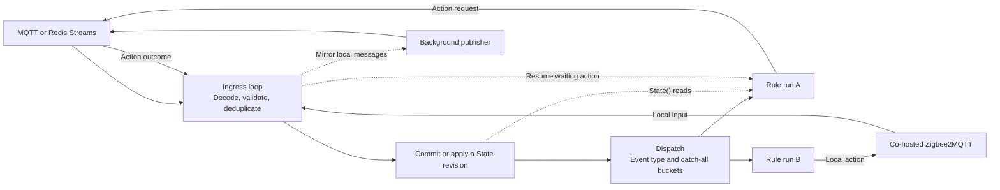
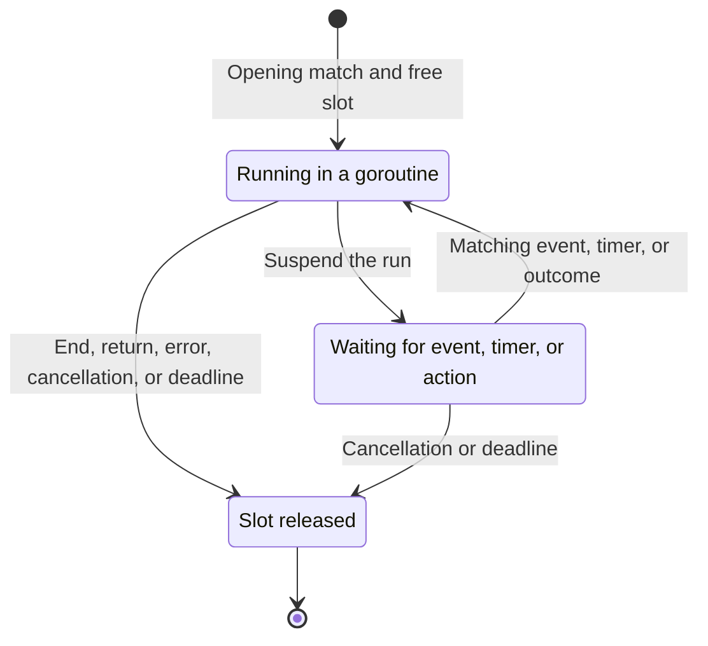

# Rules engine concurrency and latency

Chains uses one ingress loop per engine process and one Go goroutine per active rule run. Ingress serializes routing and state updates. Rule bodies execute concurrently, so one rule can wait for a device while others continue processing events.

## Event path

The dispatcher checks triggers and waiting runs indexed under the incoming event type, plus catch-all patterns. A selector with `type="keyboard.key"` goes in that type's bucket. A selector with just `device_class=light` goes in the catch-all bucket. Remaining fields are checked against each device patch. A matching batch reaches each trigger or wait once, after its full revision is visible to the process. The dispatcher lock covers matching, waking waits, and admitting new runs. Rule bodies execute outside that lock. [Ingress](../engine/engine.go#L117) · [Dispatcher](../rules/runtime.go#L134)

On the authority with Zigbee2MQTT enabled, local messages enter the same ingress loop directly. The engine dispatches locally and mirrors to the Chains bus through a separate publisher. Local actions call the bridge directly. The bridge still talks to Zigbee2MQTT over its source MQTT connection. The engine suppresses its own mirrored copies so they don't retrigger local rules. [Hosted service](../engine/local.go#L41) · [Echo suppression](../engine/engine.go#L174)

## A rule run and its slot

A rule defaults to one concurrent run. With `rule.concurrency = 3`, suppose opening matches A, B, C, and D arrive before any run finishes. A, B, and C start, each with its own variables and execution position. D's opening match is skipped because all slots are occupied. If D also matches an existing `Event()` wait, that wait can still resume. One event can wake several matching waits and start runs in other rules, which have their own limits. [Run admission](../rules/runtime.go#L173) · [Event waits](../rules/runtime.go#L259)

Waiting runs hold their slots but park their goroutines on channels or timers. Go schedules ready goroutines across available OS threads and cores. Statements proceed in order within a run. Separate runs can issue actions or finish in a different order. The engine has a per-rule admission limit and no process-wide rule worker pool.

The default run deadline is five minutes from the opening match. Later matches refresh the 10,000-step interpreter budget while the original deadline stays in force. The budget catches tight loops. Deadline and cancellation checks occur at interpreter steps, so an expensive individual operation can take time to return. Actions have a default ten-second timeout within the time remaining in the run. [Execution limits](../rules/runtime.go#L220) · [Action timeout](../engine/engine.go#L88) · [Action wait](../engine/engine.go#L529)

## Where CPU time and latency accumulate

- **Computation.** CPU-heavy runs share CPU time with ingress and other runs. Lowering `rule.concurrency` limits how many copies of a heavy rule compete. For genuinely heavy computation, a separate service can do the work behind an `Action()`, leaving the rule parked until the outcome. Processes sharing saturated cores still compete for CPU.
- **Ingress and dispatch.** One loop per process decodes, validates, deduplicates, and routes messages. Heavy ingress or broad selectors can delay matching and action replies. MQTT can drop deliveries when its 1,024-entry buffer fills. Redis Streams applies backpressure by pausing delivery into its full buffer. [Ingress](../engine/engine.go#L117) · [MQTT overflow](../bus/mqtt.go#L274) · [Redis delivery](../bus/redis.go#L307)
- **State and publication.** The state authority serializes SQLite commits and holds its state write lock during each commit. `State()` reads the process's in-memory view. Redis sends through one writer connection per adapter, so concurrent publications can queue there. Zigbee2MQTT's local dispatch can continue if its mirroring queue fills, while some remote observers miss those bus copies. [State read](../state/state.go#L74) · [State commit](../state/state.go#L187) · [Redis writer](../bus/redis.go#L321) · [Mirror queue](../engine/local.go#L90)

## Splitting work across engine processes

Run one state authority and give each worker its own engine ID and rule files. Workers receive revisioned state updates and recover their local view from the authority after a gap. A worker can select event types with `-types`, alongside the engine's control subscriptions. For example, a keyboard worker can subscribe to `keyboard.key` while another worker handles Frigate events. Each gets a separate ingress loop and Go scheduler.

Assign each action-producing rule to one process. If two workers load the same rule and both receive its trigger, both may execute it. Rule runs are live-only. A worker can miss ordinary triggers while resynchronizing state, and a restart ends any runs already waiting. [Deployment settings](../README.md#configure-and-extend) · [Subscription handling](../cmd/chains/main.go#L122) · [State synchronization](../engine/engine.go#L241)

## Operator activity

The operator API uses a dedicated broker observer on the authority, independent of the rule ingress subscription. Optional rule traces use a bounded queue with a background consumer. The runtime gives up the trace record when the queue fills and continues rule execution. A slow watch connection can fall behind the authority's in-memory activity history. Watch reports that gap and resumes from the remaining records. Observer and trace work still share process CPU with the authority. [Operator setup](operator-cli.md)

## What we measure today

The [existing benchmark](../engine/integration_test.go#L377) measures p50 and p99 sensor-event-to-action-request latency and peak sampled delivery backlog. It exercises one narrowly subscribed rule in bursts of 32. Its measurement stops when the target receives the action request.

Two future improvements are a mixed-load benchmark and reuse of decoded event fields. Mixed load would combine latency-sensitive key events, bursty Frigate traffic, concurrent state writes, and actions awaiting replies. Track tail latency, queue depth, skipped matches, and transport drops. The dispatcher currently decodes fields for matching and builds them again for each new run that binds the event. Reusing the decoded fields would reduce work under the dispatch lock during fan-out. [Dispatcher](../rules/runtime.go#L134) · [Event binding](../rules/runtime.go#L179)
